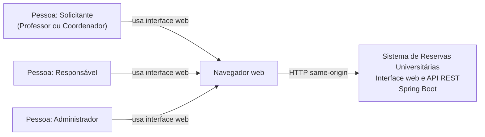
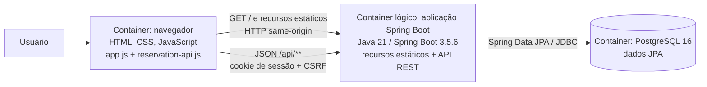
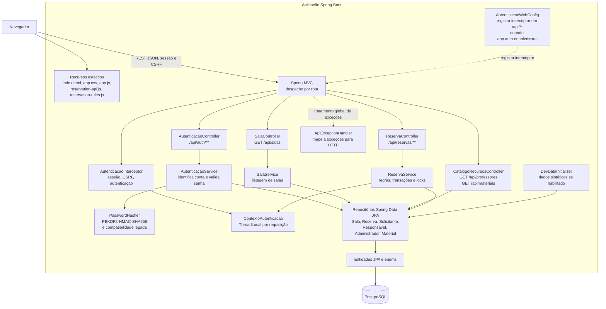

# Arquitetura Atual e Análise ATAM

**Escopo:** descrição da arquitetura implementada e análise qualitativa de trade-offs, riscos e decisões pendentes.
**Base da análise:** código, configuração e documentação presentes no repositório; nenhum teste foi executado para produzir este documento.
**Vocabulário:** **Fato observado** refere-se a comportamento/estrutura encontrado em fonte ou configuração; **análise** é a interpretação ATAM; **proposta** é uma recomendação futura, não uma decisão já tomada.

Esta consolidação complementa, sem substituir, o [diagrama de componentes](prd/modelagem/estatica/componentes.md), o [diagrama de classes](prd/modelagem/estatica/classes.md), os [fluxos de sequência](prd/fluxos-sequencia.md), o [contrato OpenAPI](openapi.yaml), o [guia da API](api-reservas.md) e a [RTM](rtm.md). Em caso de divergência, a arquitetura descrita abaixo prioriza o código/configuração atual; os documentos conceituais continuam sem alteração.

## 1. C4 — arquitetura implementada

### Nível 1 — Contexto

**Fato observado:** a aplicação organiza solicitações e decisões de reserva. Os usuários são Solicitante (inclui contas Professor e Coordenador), Responsável e Administrador. O acesso pela interface ocorre no navegador. Não foi identificada integração em execução com serviço institucional de identidade, e-mail, mensageria ou outro sistema externo.



O PostgreSQL é um container interno do sistema, apresentado no nível 2. CI, JMeter e Testcontainers são ferramentas de verificação, não atores ou integrações do sistema em execução.

### Nível 2 — Containers

**Fato observado:** a interface HTML/CSS/JavaScript está empacotada em `src/main/resources/static/` e é servida pela mesma aplicação Spring Boot que expõe a API. O navegador chama rotas `/api/**` na mesma origem. PostgreSQL armazena as entidades JPA. O `docker-compose.yml` inicia somente o banco; não há container de aplicação descrito nele. A aplicação é iniciada separadamente pelo Maven Wrapper ou como processo Java.



**Deploy local observado:** Compose configura o PostgreSQL; o processo Spring Boot usa `DB_URL`, `DB_USER` e `DB_PASSWORD`, com valores locais padrão. O endereço `SESSION_COOKIE_SECURE` é configurável e tem padrão `false`; `APP_AUTH_ENABLED` tem padrão `true`; `APP_SEED_ENABLED` tem padrão `true`. A configuração JPA define `spring.jpa.hibernate.ddl-auto=update`. Esses padrões e o banco local não comprovam uma topologia ou configuração de produção.

**Persistência:** entidades JPA `Reserva`, `Sala`, `Solicitante`, `Responsavel`, `Administrador` e `Material`; relações de reserva com sala/solicitante, possíveis decisores e associações de professores/materiais. Professores reutilizam `Solicitante` com tipo `PROFESSOR`. O detalhamento dos campos e relações está no [diagrama de classes](prd/modelagem/estatica/classes.md). Não foi identificada ferramenta dedicada de migração de schema.

### Nível 3 — Componentes principais da aplicação

O diagrama representa as chamadas encontradas, não componentes futuros. `ContextoAutenticacao` é contexto de execução usado pelos serviços, não um serviço remoto.



#### Interfaces e responsabilidades

| Componente | Evidência e papel atual |
|---|---|
| Recursos estáticos e cliente HTTP | `index.html`, `js/app.js`, `js/reservation-api.js` e `js/reservation-rules.js`; mantêm estado da interface no navegador e chamam a API na mesma origem. |
| Autenticação HTTP | `AutenticacaoWebConfig` aplica o interceptor a `/api/**` se habilitado. `AutenticacaoInterceptor` permite `GET /api/auth/csrf` e `POST /api/auth/login` sem sessão, exige sessão nas demais rotas e exige CSRF em métodos mutáveis. |
| Autenticação de contas | `AutenticacaoController` inicia/consulta/encerra sessão; `AutenticacaoService` procura contas nos três repositórios e verifica credenciais; `PasswordHasher` grava/verifica hash e suporta atualização de senha legada após autenticação válida. |
| Catálogo de salas | `SalaController` chama `SalaService`, que lista por `SalaRepository`. Não há CRUD administrativo nem filtros implementados nesta superfície. |
| Catálogos de professores e materiais | `CatalogoRecursosController` consulta diretamente `SolicitanteRepository` e `MaterialRepository`; professores retornam de solicitantes com tipo Professor. |
| Reservas | `ReservaController` delega ao `ReservaService` solicitação, consulta, listagem, alteração, cancelamento e decisão de aprovação/rejeição. O serviço aplica validações de intervalo, perfil/posse, estado de sala e conflitos. |
| Segurança de domínio | `ContextoAutenticacao` oferece verificações de identidade, perfil, posse e acesso à fila. O contexto usa `ThreadLocal` e é instalado/limpo pelo interceptor no ciclo síncrono do MVC. |
| Persistência e consistência | Repositórios Spring Data JPA consultam entidades e obtêm locks pessimistas para sala, reserva, professor e material. Métodos de escrita de `ReservaService` são transacionais; IDs de professores e materiais são ordenados antes dos locks para determinismo. |
| Erros HTTP e inicialização | `ApiExceptionHandler` converte exceções mapeadas em respostas HTTP; `DevDataInitializer` cria dados sintéticos quando `app.seed.enabled=true`. |

O diagrama de componentes existente é uma visão útil, mas algumas setas são conceituais: no código, autenticação passa por `AutenticacaoService` antes dos repositórios; catálogo usa repositórios diretamente; e autenticação pode ser desligada por configuração. Os fluxos de sequência documentam intenções do produto, não garantem que auditoria, bloqueio temporal, alterações pendentes ou validação docente estejam implementados.

## 2. ATAM — análise de trade-offs

### Objetivos e atributos de qualidade

Os objetivos são derivados dos RNFs e dos impactos registrados no [inventário de regras e riscos](testes/inventario-regras.md). Os estados citados são os da [RTM](rtm.md), não uma reavaliação nesta análise.

| Atributo | Objetivo arquitetural | Requisitos relacionados |
|---|---|---|
| Segurança | Identificar a conta, limitar operações por perfil/posse e proteger mutações contra CSRF; evitar configuração local insegura em implantação real. | RF01–RF02; RNF-ISO-06; INV-08/10/12 |
| Confiabilidade e concorrência | Impedir dupla alocação de sala, professor ou material e manter transações consistentes. | RF08–RF09; RNF-ISO-05; INV-02/03 |
| Adequação funcional | Disponibilizar o ciclo implementado de reserva e não confundir capacidades pendentes com as existentes. | RF06–RF16; RNF-ISO-01 |
| Desempenho | Medir consultas e operações sob carga representativa, com critérios aprovados e evidências reproduzíveis. | RNF-ISO-02; INV-03 |
| Capacidade de interação | Manter a interface responsiva e comunicar estados/erros sem mascarar falhas. | RF17; RNF-ISO-04; INV-17 |
| Manutenibilidade e flexibilidade | Preservar contrato REST, rastreabilidade, execução verificável e ambientes suportados. | RF18; RNF-ISO-07/08; INV-11/14 |
| Segurança operacional (safety) | Decidir, com a equipe docente, se são necessários controles adicionais para salas/materiais. | RNF-ISO-09 |

### Árvore de utilidade

Prioridades **P1/P2/P3** abaixo são ordem qualitativa desta avaliação, não pontuações ou metas aprovadas. P1 deriva principalmente de impactos altos/críticos já registrados; onde o inventário não define prioridade, o motivo é explicitado.

```text
Utilidade do sistema de reservas
├── P1 — Segurança
│   ├── Sessão, perfil, posse e CSRF aplicados às rotas REST [RF01/RF02, RNF-ISO-06]
│   └── Configuração de produção não inicia com autenticação desligada,
│       seed de demonstração ou cookie inseguro [risco de implantação a validar]
├── P1 — Confiabilidade
│   ├── Solicitações simultâneas conflitantes não criam dupla alocação [RF08/RF09, INV-02/03]
│   └── Estado/decisão da reserva permanece consistente sob concorrência [RF10/RF15, INV-04/09]
├── P2 — Desempenho
│   └── Latência e throughput de consulta/criação medidos em carga aprovada [RNF-ISO-02]
├── P2 — Adequação e interação
│   ├── Operações suportadas não mascaram erros nem exibem sucesso falso [RF06/RF17]
│   └── Jornadas e acessibilidade validadas em ambiente/navegadores definidos [RNF-ISO-04/08]
└── P2/P3 — Evolução funcional e governança
    ├── Implementar aprovação de alterações de horário [RF06/RF10, INV-04]
    ├── Definir manutenção temporal, auditoria e transições ausentes [RF11/RF14/RF15]
    └── Definir integrações/notificações e critérios safety, se aplicáveis [RF19, RNF-ISO-03/09]
```

### Cenários de qualidade priorizados

| Atributo de qualidade | Ambiente | Estímulo | Resposta esperada do sistema | Medida ou critério de resposta | Prioridade |
|---|---|---|---|---|---|
| Confiabilidade / concorrência | PostgreSQL 16; solicitações HTTP concorrentes submetidas ao fluxo transacional de reservas, com autenticação conforme a configuração da execução. | Duas requisições disputam o mesmo intervalo e sala, ou um mesmo professor/material em reservas distintas. | Aceitar no máximo uma solicitação conflitante e retornar conflito à concorrente; permitir intervalos adjacentes quando não há sobreposição. | Critério mensurável documentado: para cada disputa conflitante, no máximo uma persistência aceita; testes PostgreSQL existentes cobrem sala, professor e material. Meta de latência: **pendente de definição**. | **P1** |
| Segurança / autorização | Aplicação Spring MVC com `app.auth.enabled=true`, sessão HTTP e CSRF habilitados; rota protegida acessada por HTTP. Jornada integrada completa com banco não foi identificada. | Requisição sem sessão, mutação com token CSRF inválido ou conta autenticada que tenta operação fora do perfil/posse. | Sem sessão: rejeitar com 401; CSRF inválido e acesso proibido: rejeitar com 403; não efetuar a mutação negada. | Critérios HTTP definidos pelo interceptor/contexto; confirmar por rota e perfil em teste integrado autenticado. Cobertura integrada completa: **não medida/não identificada**. | **P1** |
| Segurança operacional de configuração | Ambiente não local de implantação, ainda não caracterizado; defaults atuais incluem seed habilitado e cookie `Secure` desabilitado. Nenhum deployment de produção foi identificado. | A aplicação inicia sem configuração operacional explícita para autenticação, seed, cookie HTTPS, segredos ou schema. | O comportamento de inicialização segura ainda não está definido como requisito; evitar considerar defaults locais adequados à produção até decisão/configuração explícita. | Política de produção, ambiente e teste de configuração segura: **pendente de definição**; não há evidência de implantação insegura. | **P1 — condicional** |
| Desempenho | Baseline local documentado em `docs/performance/resultado-01.md`: Java 21.0.13, Spring Boot 3.5.7, JMeter 5.6.3 e PostgreSQL 16.16 em contêiner descartável. JTL compactados estão versionados; relatórios HTML ficam em `target/`. | Carga exploratória de consulta, criação e contenção conforme os planos JMeter. | Servir as requisições sem falhas inesperadas e observar latência/throughput; metas oficiais ainda não foram aprovadas. | Em 13/11/2026, 10 usuários/60 s: consulta com 35.225 amostras, 100% `200`, p95 26 ms e 588,12 req/s; criação com 7.702 `201` e `Location`, p95 112 ms e 131,72 req/s; contenção única de 50 requisições com 1 `201` e 49 `409` esperados. Autenticação foi desligada no processo isolado. Esses dados locais não caracterizam produção nem autorizam conclusão de segurança. | **P2** |
| Confiabilidade / recuperação | Aplicação síncrona conectada ao PostgreSQL; disponibilidade/recovery do banco não especificada. | PostgreSQL fica indisponível durante uma leitura ou escrita de reserva. | A operação não deve comunicar sucesso sem persistência; contrato de erro, retry e recuperação não está definido. | Política de timeout, retry, disponibilidade e recuperação: **pendente de definição**; cenário automatizado específico de falha do banco: **não identificado**. | **P2** |
| Capacidade de interação / interoperabilidade | Navegador same-origin consumindo a API REST; estados de carregamento, validação e erro do frontend. | Backend retorna validação/conflito ou a API fica indisponível/retorna conteúdo inválido. | Exibir erro compreensível e não indicar sucesso quando a operação falha; preservar o estado conforme resposta real da API. | Testes Node existentes verificam contrato/regras, mas responsividade visual, acessibilidade e compatibilidade de navegadores: **não medidos**; critérios correspondentes **pendentes de definição**. | **P2** |

### Pontos de sensibilidade

| Ponto | Efeito arquitetural |
|---|---|
| `APP_AUTH_ENABLED` / `app.auth.enabled` | Desabilitar remove o interceptor de todas as rotas `/api/**`; o contexto de autorização depende do interceptor. É necessário distinguir configuração de teste de configuração de execução. |
| Sessão HTTP, CSRF e origem | O cliente depende de cookie same-origin e token `X-CSRF-Token`; mudança para outra origem/proxy exige rever cookies, CSRF e CORS. Não há JWT ou provedor externo no código atual. |
| Locks e limite transacional | Solicitação/alteração bloqueia registros dos recursos e consulta conflitos dentro de transações. Remover lock, alterar ordem/escopo transacional ou trocar o banco pode mudar a garantia de concorrência e o throughput. |
| Banco PostgreSQL | Semântica/compatibilidade do lock pessimista e comportamento sob contenção dependem do banco; a configuração e os testes usam PostgreSQL. |
| `ThreadLocal` no contexto de autenticação | O contexto assume processamento síncrono no ciclo Servlet/MVC e limpeza em `afterCompletion`. Execução assíncrona/reutilização fora desse ciclo exigiria propagação e limpeza apropriadas. |
| `ddl-auto=update` e inicializador | Schema e dados iniciais são alterados no startup conforme configuração. Em produção, isso afeta previsibilidade, governança e segurança dos dados. |
| Status e tipos persistidos como string | `StatusReserva`, `StatusSala`, `TipoSolicitante` e tipos de aprovador participam de contratos REST e/ou persistência; mudanças de nome/semântica precisam considerar código, banco, frontend e OpenAPI. |
| Monólito com frontend e API | Compartilhar origem simplifica sessão/CSRF e implantação local; também acopla ciclo de deploy e escala da interface/API. |

### Trade-offs arquiteturais

| Escolha observada | Benefício | Custo/risco |
|---|---|---|
| Aplicação monolítica Spring Boot com recursos web estáticos | Uma origem para UI/API, sem pipeline separado de frontend; implantação e desenvolvimento local simples. | Escala e release da UI/API são acoplados; separar a UI exige decisão sobre sessão, CSRF e origem. |
| API MVC síncrona com transações e locks pessimistas | Limite de consistência explícito para operações concorrentes sobre recursos. | Locks mantidos durante a transação podem reduzir throughput e ampliar espera sob contenção; resultados JMeter registrados mostram que criação merece medição, não provam causa. |
| Sessão HTTP e CSRF, sem JWT | Identidade armazenada no servidor; fluxo compatível com navegador same-origin e sessão expirada por inatividade. | Exige gestão de sessão/cookies e proteção CSRF; distribuição horizontal futura precisaria tratar armazenamento/afinidade de sessão, não especificados atualmente. |
| Repositórios Spring Data JPA e schema Hibernate `update` | Menos código de persistência e inicialização simples em desenvolvimento. | Evolução de schema não está versionada por migrações identificadas; `update` reduz controle explícito de implantação. |
| Professores como `Solicitante` tipado e materiais como entidade | Reutiliza conta de solicitante para alocação docente e persiste associação de materiais à reserva. | Responsabilidades e validações de cada tipo ficam ligadas ao modelo atual; o PRD ainda aponta cadastro administrativo como pendente. |

### Riscos arquiteturais e não riscos

| Classificação | Observação fundamentada | Relação/ação |
|---|---|---|
| **Risco — alto** | O switch de autenticação pode remover a proteção de todas as rotas REST se desligado por configuração; o E2E desliga autenticação para testar HTTP/persistência. | RF01/RF02 e RNF-ISO-06. Manter a configuração desativada apenas em contexto controlado e cobrir a execução integrada autenticada. |
| **Risco — operacional** | Valores locais, seed de demonstração ativado por padrão, `SESSION_COOKIE_SECURE=false` por padrão e `ddl-auto=update` não constituem política segura de produção. | Definir configuração de produção e gestão de segredos antes de disponibilizar o sistema fora do ambiente local; não há implantação de produção comprovada. |
| **Risco — alto** | A consistência contra concorrência depende do serviço transacional, bloqueios pessimistas e PostgreSQL, sem constraint de exclusão indicada na modelagem existente. | RF08/RF09, RNF-ISO-05, INV-02/03. Preservar e verificar esse caminho ao alterar persistência ou paralelismo. |
| **Risco — médio** | Falha, recuperação, backup, timeout e retry do banco não têm política arquitetural documentada. | Definir disponibilidade/recuperação se o sistema precisar operar além do ambiente acadêmico local. |
| **Risco — evidência** | JMeter tem planos e resultados atuais locais, mas JTL/HTML estão em `target/` (ignorado pelo Git) e não são publicados pela CI; metas continuam experimentais. | RNF-ISO-02: preservar os artefatos fora do diretório temporário e formalizar carga/limites antes de declarar conformidade. |
| **Risco — evolução** | Aprovação de alterações de horário, manutenção temporal, auditoria completa e estados finais ainda não estão completamente representadas na implementação. | RF10/RF11/RF14/RF15 e INV-04/07/09/13; decisões funcionais precedem a implementação. |
| **Risco — escopo de integração** | O cliente HTTP de notificação e testes WireMock existem, mas divergem do PRD vigente, que pede simulação interna sem serviço externo. | RF19/RN11 requerem decisão explícita ou substituição da integração antes de declarar conformidade. |
| **Não risco confirmado** | O código atual e testes de integração implementam consulta de conflito e bloqueios para sala, professor e material. | Não classificar ausência de mecanismo de conflito como risco atual; a cobertura documental de alguns cenários ainda diverge. |
| **Não risco confirmado** | A aplicação não contém dependência ou chamada identificada a sistema externo em runtime. | Não existe falha de integração externa demonstrada; a compatibilidade futura permanece decisão pendente. |
| **Limite de escopo, não defeito isolado** | CRUD de contas/recursos, relatórios, auditoria, validação docente e movimentação de material são capacidades pendentes no PRD/RTM. | Não descrever como componentes existentes; revisar prioridades segundo os impactos do inventário, não apenas por ausência de código. |

## 3. Decisões arquiteturais (ADRs)

O repositório não contém diretório formal de ADRs. O [decision log da story 1.1](../.ai/decision-log-1.1.md) é gerado automaticamente e registra escolhas daquela entrega; a [story 1.2](stories/1.2.integracao-frontend-api-reservas.story.md) registra uma decisão de autenticação futura. As entradas abaixo preservam essa proveniência e não elevam escolhas observadas a decisões formais do projeto.

### Decisões registradas em stories

| Registro | Contexto e decisão registrada | Alternativas consideradas | Consequências conhecidas |
|---|---|---|---|
| Story 1.1 — servir interface pelo Spring Boot | Para a entrega frontend-only, sem manifesto de build frontend, a story decidiu servir HTML/CSS/JavaScript como recursos estáticos da aplicação Spring Boot. A implementação atual mantém esses arquivos em `src/main/resources/static/`. | Adicionar framework/pipeline frontend; adicionar endpoints backend à entrega frontend-only. | A UI e API podem compartilhar origem e release; a UI depende do processo Spring Boot e seu ciclo de deploy. |
| Story 1.1 — reutilizar enums do domínio | A story decidiu reutilizar os valores existentes de `StatusSala` e `StatusReserva` na interface para refletir o modelo Java. | Criar estados próprios na UI ou labels sem relação com os enums. | Status são contratos compartilhados entre Java, respostas da API e frontend; mudanças precisam ser coordenadas. |
| Story 1.1 — estado da interface em memória | A story decidiu manter alterações do protótipo em memória e testar regras de domínio com testes Node nativos, sem persistir estado no `localStorage`. O frontend atual mantém estado em objetos JavaScript e obtém dados da API. | Persistir em `localStorage`; adicionar framework de teste frontend. | O servidor é fonte dos dados de reserva; recarregar a página depende da API/sessão, não de uma cópia local durável. |
| Story 1.2 — sessão HTTP sem JWT | A story registra a decisão aprovada para autenticação: contas persistidas e sessão HTTP, sem JWT. O código atual implementa sessão, cookie, CSRF e autenticação de perfis. | JWT. | Mantém o fluxo same-origin e o estado de autenticação no servidor; exige política de sessão/cookie e não constitui SSO institucional. |

### Decisões pendentes — não assumidas nesta análise

| Tema | Contexto | Decisão necessária e alternativas ainda abertas | Consequência de não decidir |
|---|---|---|---|
| Configuração de produção | Há defaults de desenvolvimento, seed automático configurável, autenticação configurável e schema `update`; não foi encontrada definição de deployment. | Definir perfis, fonte de segredos, seed em produção, HTTPS/cookie, criação/evolução de schema. | Não é possível afirmar que a configuração de produção esteja segura ou repetível. |
| Evolução do schema | JPA `ddl-auto=update`; não foi identificada ferramenta de migração. | Manter atualização automática apenas em ambiente local ou adotar migrações versionadas; decisão do projeto/equipe. | Mudanças de entidade podem produzir evolução não controlada entre ambientes. |
| Aprovação de reservas novas | RF10/RN05 exigem aprovação do Responsável; o serviço agora recusa aprovação por Administrador, sem depender da classificação demonstrativa do recurso. | Implementar pedido pendente para alteração de horário, decisão do Responsável, revalidação e expiração. | Aprovação de reservas novas está alinhada; alteração de horário permanece parcial. |
| Notificação externa | O código atual envia eventos de reserva por HTTP, embora o PRD vigente peça simulação interna sem dependência externa. | Resolver a divergência entre implementação e RN11 do PRD. | Não declarar RF19 conforme enquanto a implementação permanecer exclusivamente externa. |
| Operação e desempenho | Carga-alvo, p95 oficial, disponibilidade, backup, recuperação e ambientes suportados não estão definidos. | Aprovar metas e contexto de operação antes de escolher mecanismos ou declarar qualidade. | Há resultados locais atuais de consulta e contenção, além de resultados históricos de criação; nenhum demonstra cumprimento de meta oficial, ainda não aprovada. |
| Safety e controles administrativos | A aplicabilidade de safety depende da equipe docente; CRUD, bloqueios por período e auditoria têm lacunas na RTM. | Validar aplicabilidade e fechar critérios funcionais antes de selecionar controles. | Não assumir agenda, trilha de auditoria ou restrição adicional como capacidade atual. |

## 4. Conclusão e prioridades

### Principais riscos arquiteturais

1. **Segurança operacional de configuração:** diferenciar explicitamente execução local/teste de produção; padrões de seed, cookie, autenticação e DDL precisam de política de implantação. Isso não afirma que exista uma implantação de produção.
2. **Garantia de concorrência:** o caminho correto depende de transações e locks no banco; mudanças de serviço, lock ou mecanismo de persistência devem preservar o contrato RF08/RF09.
3. **Autorização integrada:** controles existem no interceptor e no contexto de domínio, mas não há jornada E2E identificada com banco e autenticação habilitada. O E2E que desabilita o interceptor não valida esse atributo.
4. **Schema/recuperação:** falta estratégia explícita de migração, backup e recuperação para além do ambiente local com Hibernate `update`.
5. **Evidência de qualidade:** metas de desempenho são provisórias; há resultados JMeter atuais de consulta e contenção, mas seus dados brutos permanecem locais/ignorados. O workflow atual executa testes Node e impõe limites JaCoCo de 80% linhas/70% branches; JMeter continua fora da CI.
6. **Lacunas funcionais do PRD:** aprovação de alterações de horário, manutenção temporal, auditoria completa, estados operacionais, validação docente, gestão e notificações simuladas dependem de implementação ainda pendente.

### Relação com a RTM e recomendações

As prioridades abaixo não alteram status nem prioridade registrada na RTM/inventário. São recomendações arquiteturais para orientar o fechamento:

| Prioridade recomendada | Ação | Rastreabilidade |
|---|---|---|
| **P1 — segurança antes de qualquer implantação** | Definir configuração de produção (segredos, seed, cookie HTTPS, autenticação habilitada e schema) e documentar como impedir defaults locais em implantação. | RF01/RF02; RNF-ISO-06/08; INV-08. |
| **P1 — preservar integridade** | Manter locks/limites transacionais e executar evidência de concorrência em PostgreSQL para sala, professor e material nas alterações futuras. | RF08/RF09; RNF-ISO-05; INV-02/03. |
| **P1 — fechar evidência de autorização** | Complementar validação integrada com sessão real, CSRF, perfis, posse e banco, sem usar o E2E com `app.auth.enabled=false` como prova de autorização. | RF01/RF02/RF06; RNF-ISO-06; INV-08/10/12. |
| **P2 — governar dados** | Decidir e documentar estratégia de evolução do schema e requisitos operacionais de backup/recuperação, conforme ambiente-alvo. | RNF-ISO-05/08; requisito de operação ainda não formalizado. |
| **P2 — medir qualidade** | Formalizar carga e critérios; preservar JTL/relatórios fora de `target/`; complementar os níveis de verificação ainda ausentes, como validação visual em navegador. | RNF-ISO-02/07; RF17; INV-14/17. |
| **P2 — resolver regras críticas pendentes** | Fechar primeiro as decisões de RF10 e RF11, antes de implementar classificação restrita ou agenda temporal. | RF10/RF11; INV-04/05/07. |
| **P3 — completar o escopo restante** | Planejar, conforme decisão do produto, gestão, auditoria, estados operacionais, validação docente, relatórios, notificações e safety. | RF03/RF04/RF12–RF16/RF19; RNF-ISO-03/09; INV-13/15/16/18. |

Para a situação requisito a requisito, evidências e prioridade funcional vigentes, consultar a [RTM aprovada](rtm.md) e o [inventário de riscos](testes/inventario-regras.md). Esta análise não altera nem substitui esses documentos.

## Fontes analisadas

- Estrutura e stack: [README](../README.md), [pom.xml](../pom.xml), [application.properties](../src/main/resources/application.properties), [docker-compose.yml](../docker-compose.yml), [workflow CI](../.github/workflows/ci.yml) e [docker-compose de JMeter](../docker-compose.jmeter.yml).
- Arquitetura e requisitos: [componentes](prd/modelagem/estatica/componentes.md), [classes](prd/modelagem/estatica/classes.md), [fluxos de sequência](prd/fluxos-sequencia.md), [PRD](prd.md), [RF/RN](prd/requisitos-funcionais.md), [RNFs](prd/requisitos-nao-funcionais.md) e [RTM](rtm.md).
- Contratos e regras: [OpenAPI](openapi.yaml), [guia da API](api-reservas.md), [inventário de regras e riscos](testes/inventario-regras.md), [estratégia de testes](testes/estrategia.md) e [relatório JMeter](testes/jmeter/relatorio-desempenho.md).
- Decisões e histórias: [índice de decisões](../.ai/decision-logs-index.md), [decision log 1.1](../.ai/decision-log-1.1.md), [story 1.1](stories/1.1.front-end-reserva-de-salas.story.md) e [story 1.2](stories/1.2.integracao-frontend-api-reservas.story.md).
- Implementação: `src/main/java/br/com/projeto_qualidade_software/projeto/` — `api/`, `security/`, `services/`, `repositories/`, `entities/`, `enums/` e `config/`; interface em `src/main/resources/static/`.
- Evidência de teste consultada sem nova execução nesta tarefa: `src/test/java/br/com/projeto_qualidade_software/projeto/integration/ReservaPostgresIntegrationTest.java`, `ReservaApiPostgresE2ETest.java`, testes de API/segurança e resultados JMeter locais de 11/11/2026; os resultados históricos e limites permanecem descritos na RTM.
