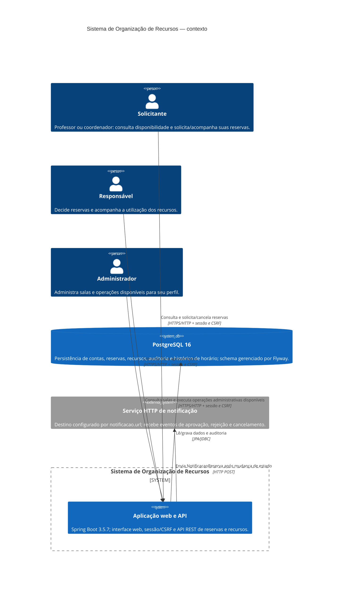

# C4 — Diagrama de contexto

**Revisão representada:** branch `release/rc1-blocker-fixes`, verificada em
2026-11-14. O diagrama mostra integrações e atores do recorte implementado; não
implica que requisitos pendentes estejam disponíveis.

## Limites e divergências

- `GET /api/auth/csrf`, `POST /api/auth/login` e arquivos estáticos iniciam o
  fluxo sem identidade; as demais rotas `/api/**` exigem sessão. Mutations
  também exigem CSRF.
- A aplicação e o PostgreSQL são integrações realmente usadas pelo recorte
  documentado. O serviço de notificação externo existe e é testado com
  WireMock, mas diverge de RF19/RN11: o requisito do projeto pede notificação
  simulada dentro do sistema, sem serviço externo. A divergência permanece
  pendente e não deve ser interpretada como requisito atendido.
- Cadastro/gestão de usuários e recursos, manutenção por período, movimentação
  de materiais, relatórios e fluxo aprovado de alteração de horário estão
  pendentes conforme [RTM](../RTM.md).

## Diagramas relacionados

- [Componentes implementados](../prd/modelagem/estatica/componentes.md)
- [Sequências críticas e limitações](../prd/fluxos-sequencia.md)
