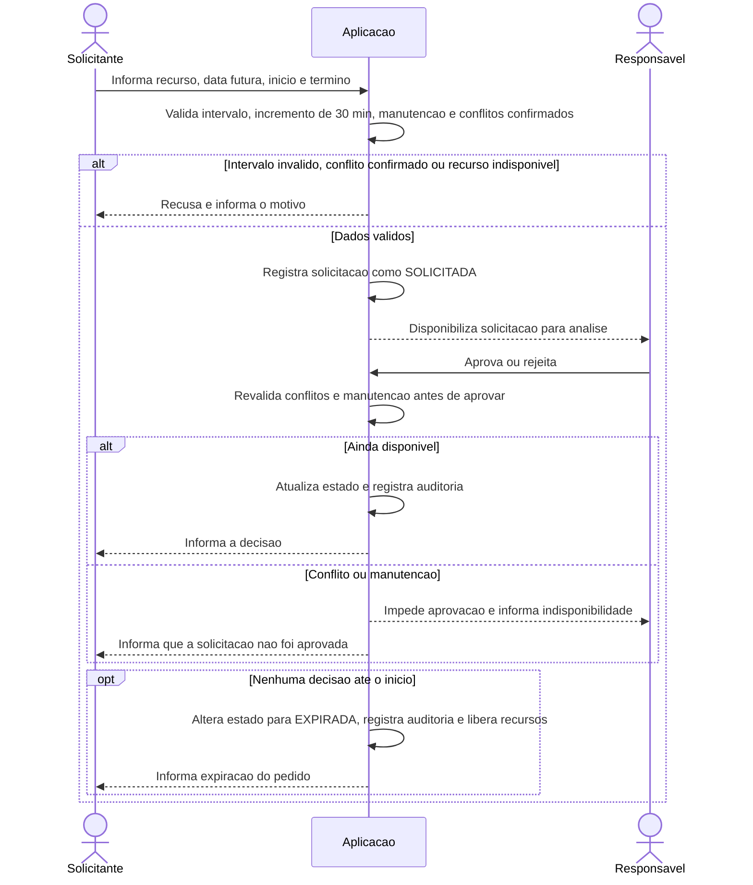
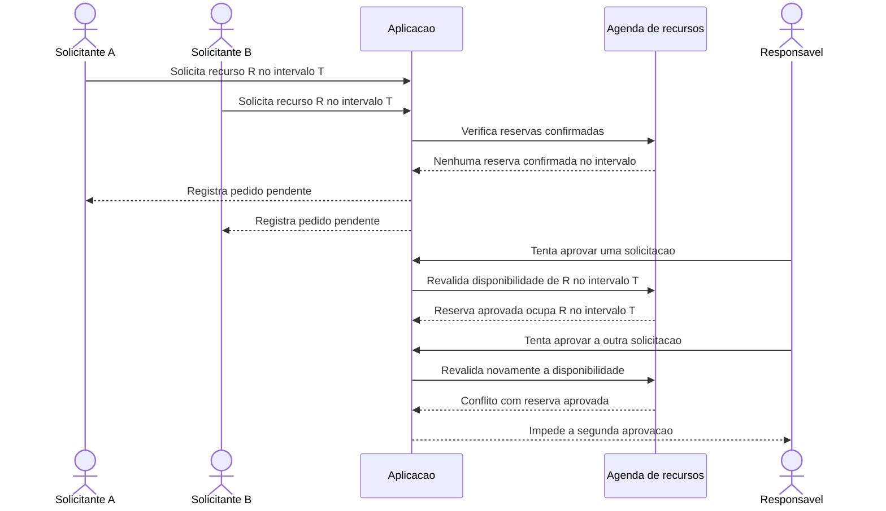
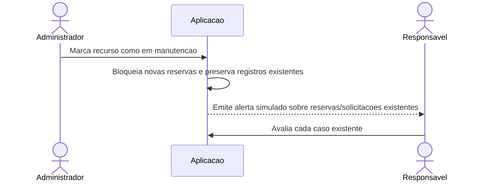
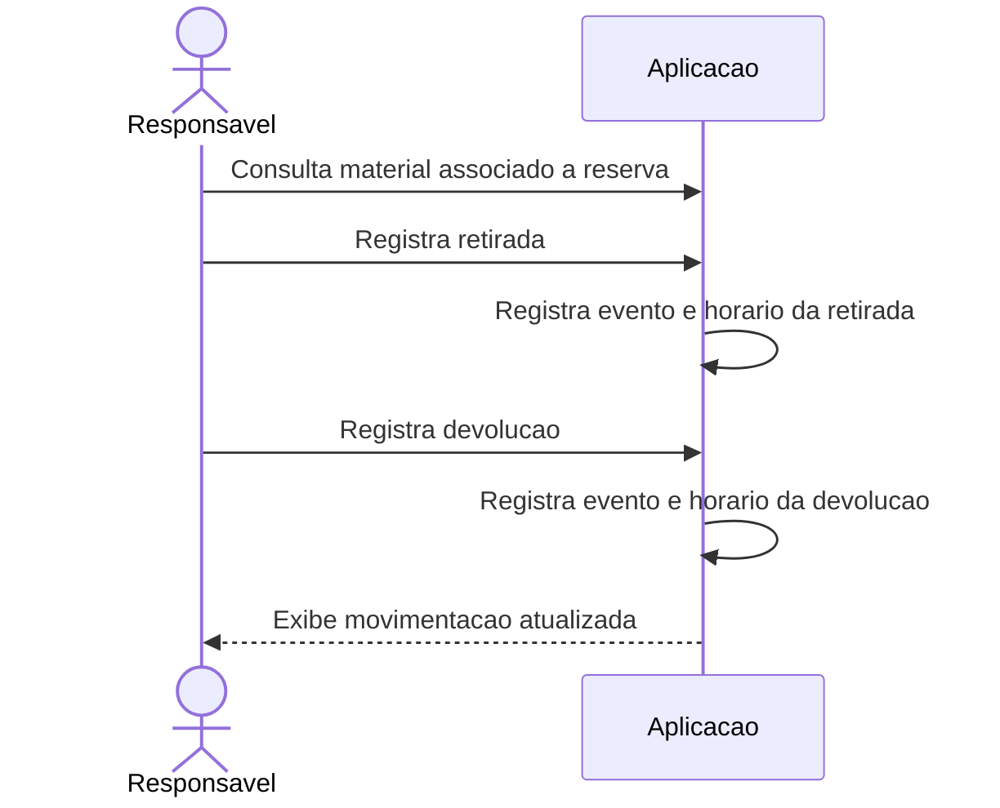

# Fluxos - Diagramas de Sequencia

Diagramas dos fluxos criticos, atualizados conforme as decisoes do [PRD principal](../prd.md). Os participantes representam papeis e responsabilidades, sem definir arquitetura tecnica.

## 1. Solicitar reserva e validar disponibilidade (RF06-RF11, RN01-RN05)



Todas as reservas novas exigem aprovacao, independentemente da classificacao de restricao. Solicitacoes pendentes podem coincidir; a revalidacao no momento da aprovacao impede que mais de uma reserva conflitante seja confirmada. Se o pedido nao for decidido ate o inicio, ele expira como `EXPIRADA`, gera auditoria e libera os recursos. Notificacoes sao simuladas dentro do sistema.

## 2. Solicitacoes simultaneas para o mesmo recurso (RF08-RF09, RN02-RN03)



Toda solicitacao exige aprovacao do Responsavel. A verificacao/confirmacao deve ser atomica sob concorrencia: apenas uma solicitacao conflitante pode ser aprovada. Intervalos adjacentes, sem sobreposicao, podem ser confirmados.

## 3. Alterar ou cancelar uma reserva (RF06, RF10, RF14-RF15, RN07, RN09-RN10)

```mermaid
sequenceDiagram
    actor S as Solicitante
    participant APP as Aplicacao
    actor R as Responsavel

    alt Alteracao de data/horario
        S->>APP: Solicita alteracao ate duas horas antes do inicio original
        APP->>APP: Valida prazo, intervalo e conflitos
        APP->>APP: Registra alteracao pendente; mantem horario original
        APP-->>R: Disponibiliza alteracao para decisao
        R->>APP: Aprova ou rejeita ate o inicio original
        APP->>APP: Revalida conflito antes de aplicar
        alt Aprovada dentro do prazo e ainda disponivel
            APP->>APP: Substitui horario e registra auditoria
        else Rejeitada, conflitada ou prazo expirado
            APP->>APP: Mantem horario original e registra decisao/expiracao
        end
    else Cancelamento
        S->>APP: Solicita cancelamento ate duas horas antes do inicio
        APP->>APP: Valida limite e altera estado para CANCELADA
        APP->>APP: Registra usuario e data/hora da mudanca
        APP-->>S: Confirma cancelamento
    end
```

Cancelamento pelo Solicitante nao exige aprovacao e pode ser feito mesmo para reserva aprovada, desde que respeitado o limite de duas horas. Apos o inicio, a reserva nao pode ser apagada. Justificativa de cancelamento nao e obrigatoria.

## 4. Manutencao de recurso (RF04, RF11, RN04)



## 5. Retirada e devolucao de material (RF13, RN08)



## Cobertura dos fluxos

| Fluxo | Requisitos | Regras de negocio |
|---|---|---|
| Solicitacao, aprovacao e disponibilidade | RF06-RF11 | RN01-RN05 |
| Concorrencia de reserva | RF08-RF09 | RN02-RN03 |
| Alteracao e cancelamento | RF06, RF10, RF14-RF15 | RN07, RN09-RN10 |
| Manutencao | RF04, RF11 | RN04 |
| Movimentacao de material | RF13-RF14 | RN07-RN08 |
