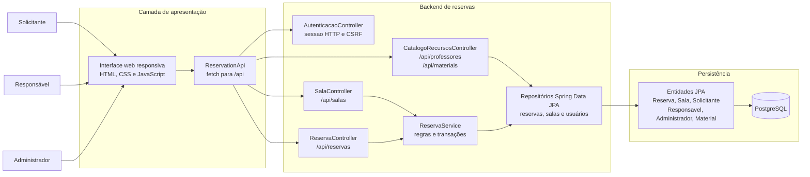

# Diagrama de Componentes — Sistema de Alocação de Recursos

**Tipo:** modelagem estática
**Status:** representação do recorte implementado e dos limites conhecidos
**Relacionado:** [classes.md](classes.md) · [requisitos-funcionais.md](../../requisitos-funcionais.md) · [requisitos-nao-funcionais.md](../../requisitos-nao-funcionais.md)

O diagrama representa a interface web integrada ao backend de reservas existente. Componentes e fluxos futuros não são apresentados como implementados.

---

## Visão geral

---

## Componentes e responsabilidades

| Componente | Responsabilidade | RFs | Situação |
|---|---|---|---|
| Interface web responsiva | Apresenta salas e fluxos de reserva; consulta e atualiza dados pela API. | RF01, RF02, RF06, RF17 | Implementada com telas por perfil autenticado; não oferece gestão de contas ou salas. |
| `ReservationApi` | Envia requisições HTTP relativas, mantém o token CSRF e trata erros de conexão/resposta. | RF01, RF02, RF06, RF07, RF15, RF18 | Implementado em `static/js/reservation-api.js`; usado pela interface servida pelo Spring Boot. |
| `AutenticacaoController` | Autentica credenciais, cria/encerra sessão HTTP e informa o perfil atual. | RF01, RF02 | Implementado em `/api/auth`; senhas são protegidas com PBKDF2 e operações mutáveis usam token CSRF. |
| `SalaController` | Expõe a listagem de salas. | RF03, RF05 | Implementado em `/api/salas`; não oferece CRUD nem pesquisa com filtros. |
| `ReservaController` | Expõe operações de solicitação, consulta, alteração, cancelamento, aprovação e rejeição. | RF06, RF07, RF15, RF18 | Implementado em `/api/reservas`; chamadas exigem sessão e validação de perfil/posse. |
| `CatalogoRecursosController` | Expõe docentes do tipo PROFESSOR e materiais, somente com ID e nome. | RF08, RF09 | Implementado em `/api/professores` e `/api/materiais`; exige sessão. |
| `ReservaService` | Valida intervalo, solicitante, estado da sala, conflitos de sala/docente/material e decisões de reserva. | RF06, RF07, RF08, RF09, RF10, RF11 | Implementado para alocação de salas, docentes e materiais. |
| Repositórios Spring Data JPA | Consultam e persistem entidades; incluem consultas de conflito e bloqueios pessimistas de sala, docente e material. | RF08, RF09 | Implementados para as entidades atuais. |
| Entidades JPA | Mapeiam reservas, salas, solicitantes, responsáveis, administradores e materiais. | RF06, RF08-RF11, RF15 | Modelo atual; detalhes em [classes.md](classes.md). |
| PostgreSQL | Armazena as entidades mapeadas pelo JPA. | Todos | PostgreSQL 16 é configurado no `docker-compose.yml`; URL e credenciais são configuráveis por variáveis de ambiente. O schema é atualizado pelo Hibernate, sem ferramenta de migração dedicada. |

---

## Interfaces entre componentes

| De | Para | Conteúdo | Observação |
|---|---|---|---|
| `ReservationApi` | `SalaController`, `CatalogoRecursosController` e `ReservaController` | Requisições REST para `/api/salas`, `/api/professores`, `/api/materiais` e `/api/reservas`. | Contrato descrito em [API de reservas](../../../api-reservas.md). |
| `AutenticacaoController` | Repositórios de usuários | Busca a conta pelo e-mail, verifica a senha e cria a sessão. | A sessão contém somente a identidade e o perfil, não a senha. |
| `ReservaController` | `ReservaService` | Dados da solicitação e ação pedida sobre a reserva. | A autorização confere perfil, ID autenticado e propriedade da reserva. |
| `ReservaService` | Repositórios | Consulta, validação e gravação das entidades. | Operações de reserva são transacionais. |
| Repositórios | Entidades JPA | Persistência e consulta de `Reserva`, `Sala` e cadastros relacionados. | Relações e campos estão em [classes.md](classes.md). |
| Interface web | Backend | Login, consulta e operações de reserva por meio do cliente HTTP. | Usa a mesma origem, cookie de sessão e token CSRF; o backend impõe permissões. |

---

## Decisões e capacidades pendentes

Permanecem pendentes cadastro/gestão de usuários e dos fluxos administrativos de recursos.

O modelo já permite alocar professores (reutilizando contas PROFESSOR) e materiais, mas ainda não possui cadastro/gestão desses recursos, bloqueios por período, movimentação de materiais ou auditoria. Consulte os [requisitos funcionais](../../requisitos-funcionais.md) para o estado de implementação.
