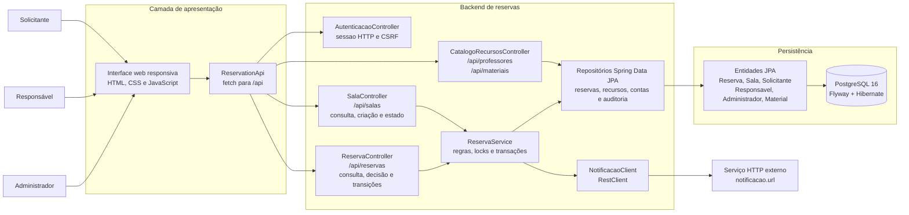

# Diagrama de Componentes — Sistema de Alocação de Recursos

**Tipo:** modelagem estática
**Status:** representação do recorte implementado e dos limites conhecidos
**Relacionado:** [C4 de contexto](../../../arquitetura/c4-contexto.md) · [classes.md](classes.md) · [requisitos-funcionais.md](../../requisitos-funcionais.md) · [requisitos-nao-funcionais.md](../../requisitos-nao-funcionais.md)

O diagrama representa a interface web integrada ao backend de reservas existente. Componentes e fluxos futuros não são apresentados como implementados.

---

## Visão geral

---

## Componentes e responsabilidades

| Componente | Responsabilidade | RFs | Situação |
|---|---|---|---|
| Interface web | Apresenta telas de perfil e fluxos implementados; consulta e atualiza dados pela API. | RF01, RF02, RF06, RF17 | Existe e usa estilos responsivos; navegador, acessibilidade e jornadas visuais ainda não foram validados nesta revisão. |
| `ReservationApi` | Envia requisições HTTP relativas, mantém o token CSRF e trata erros de conexão/resposta. | RF01, RF02, RF06, RF07, RF15, RF18 | Implementado em `static/js/reservation-api.js`; contrato do cliente validado por Node, sem E2E de navegador. |
| `AutenticacaoController` | Autentica credenciais, cria/encerra sessão HTTP e informa o perfil atual. | RF01, RF02 | Implementado em `/api/auth`; senhas são protegidas com PBKDF2 e operações mutáveis usam token CSRF. |
| `SalaController` | Lista/filtra salas, cria sala e altera estado operacional. | RF03, RF05, RF11 | Implementado parcialmente; filtros limitam-se a status e capacidade mínima, sem CRUD completo. |
| `ReservaController` | Expõe solicitação, consulta/fila, alteração direta, cancelamento, aprovação/rejeição, auditoria, histórico e transições operacionais. | RF06, RF07, RF14, RF15, RF18 | Rotas em `/api/reservas`; sessão, CSRF, perfil e posse são validados. Alterações pendentes não estão implementadas. |
| `CatalogoRecursosController` | Expõe docentes do tipo PROFESSOR e materiais, somente com ID e nome. | RF08, RF09 | Implementado em `/api/professores` e `/api/materiais`; exige sessão. |
| `ReservaService` | Valida intervalos, solicitante, sala, conflitos, perfil de aprovação, transições, expiração e auditoria. Envia notificações de estado ao cliente HTTP. | RF06-RF11, RF14-RF15, RF19 | Implementado parcialmente; criação atual também conflita com pedidos `SOLICITADA`; alteração pendente e notificação interna não existem. |
| `NotificacaoClient` | Envia `NotificacaoReserva` para serviço configurado após aprovação, rejeição ou cancelamento. | RF19 | Implementação HTTP coberta por WireMock (200/corpo, 500, timeout), divergente de RF19/RN11, que requer simulação interna. |
| Repositórios Spring Data JPA | Consultam/persistem entidades; consultas de conflito e locks pessimistas de sala, docente e material; auditoria/histórico. | RF08-RF10, RF14-RF15 | Implementados para o modelo atual; testes concorrentes usam PostgreSQL/Testcontainers. |
| Entidades JPA | Mapeiam reservas, salas, solicitantes, responsáveis, administradores, materiais, auditoria e alteração aplicada. | RF06-RF11, RF14-RF15 | Modelo parcial; movimentação de material e solicitação de mudança de horário não existem. |
| PostgreSQL | Armazena os dados do domínio e registros de auditoria. | RF01-RF16 | PostgreSQL 16 em Compose local e Testcontainers; migrations Flyway e JPA/Hibernate configuram o schema. |

---

## Interfaces entre componentes

| De | Para | Conteúdo | Observação |
|---|---|---|---|
| `ReservationApi` | `SalaController`, `CatalogoRecursosController` e `ReservaController` | Requisições REST para `/api/salas`, `/api/professores`, `/api/materiais` e `/api/reservas`. | Contrato descrito em [API de reservas](../../../api-reservas.md). |
| `AutenticacaoController` | Repositórios de usuários | Busca a conta pelo e-mail, verifica a senha e cria a sessão. | A sessão contém somente a identidade e o perfil, não a senha. |
| `ReservaController` | `ReservaService` | Dados da solicitação e ação pedida sobre a reserva. | A autorização confere perfil, ID autenticado e propriedade da reserva. |
| `ReservaService` | Repositórios | Consulta, validação e gravação das entidades. | Operações de reserva são transacionais. |
| `ReservaService` | `NotificacaoClient` | Evento com estado após aprovar, rejeitar ou cancelar. | Falha/timeout HTTP é registrada e não reverte a mudança; integração é externa e divergente de RN11. |
| `NotificacaoClient` | Serviço externo | `POST` de `NotificacaoReserva`. | URL configurada por `notificacao.url`; não existe rota de notificação recebida pela aplicação. |
| Repositórios | Entidades JPA | Persistência e consulta de `Reserva`, `Sala` e cadastros relacionados. | Relações e campos estão em [classes.md](classes.md). |
| Interface web | Backend | Login, consulta e operações de reserva por meio do cliente HTTP. | Usa a mesma origem, cookie de sessão e token CSRF; o backend impõe permissões. |

---

## Decisões e capacidades pendentes

Permanecem pendentes gestão completa de usuários/recursos, filtros por tipo,
localização ou competência, manutenção por período, validação docente,
aprovação de alterações de horário, retirada/devolução, relatórios e
notificação interna. A auditoria cobre criação e transições, mas não toda
alteração direta de horário. Consulte a [RTM única](../../../RTM.md) e os
[requisitos funcionais](../../requisitos-funcionais.md) para os estados atuais.
